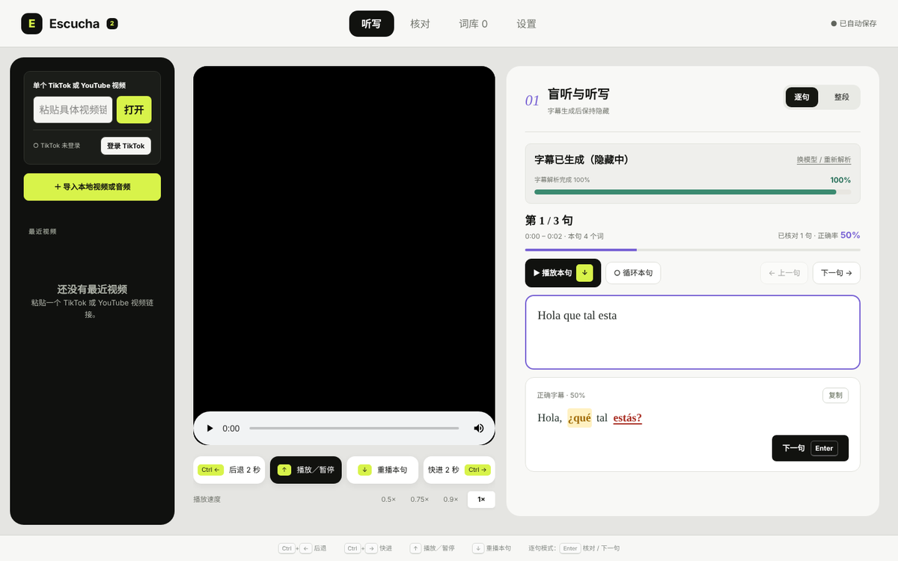
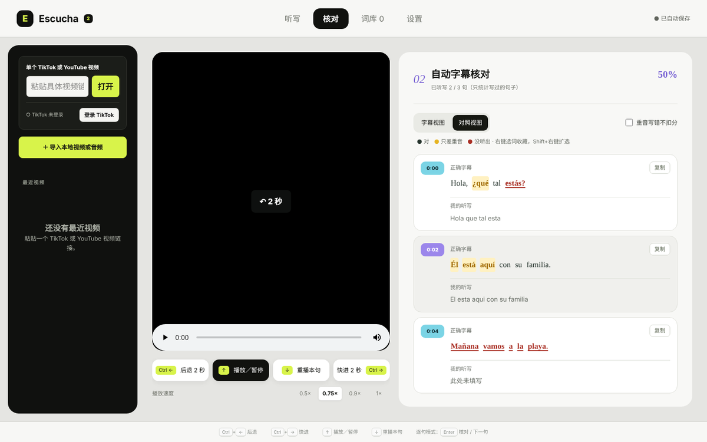
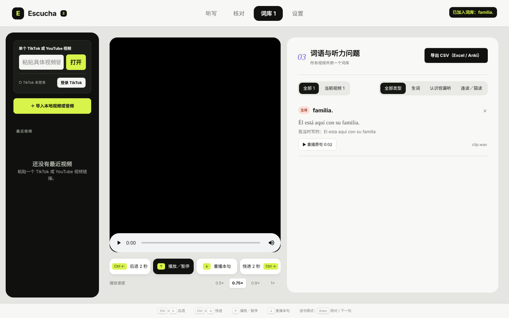

# ES Escucha 2 · 西班牙语听写练习 · Spanish Dictation Practice

> **English:** A free Windows desktop app for **Spanish listening and dictation practice** with real videos. Open a TikTok or YouTube link (or a local video/audio file); the app generates Spanish subtitles **locally and offline with whisper.cpp**, keeps them hidden while you listen and type, then checks your dictation word by word and lets you save missed words to a vocabulary list (CSV / Anki export). [Download the latest release →](https://github.com/binx-beep/es-escucha/releases/latest)

**关键词**：西班牙语听力 · 西语听写 · 西班牙语学习 · 精听 · 听写练习 · 自动字幕 · 西语字幕生成 · TikTok 西语 · YouTube 西语 · whisper 字幕 · Anki 生词本

一款 Windows 桌面软件，用真实的西班牙语视频练听力：打开 TikTok / YouTube 链接或本地视频，软件在**本机**自动生成西语字幕并先隐藏起来，你边听边写，写完再对照字幕，找出没听出来的词，存进自己的词库。

字幕识别用的是开源的 [whisper.cpp](https://github.com/ggml-org/whisper.cpp)，完全在本地运行：不需要账号、不需要 API Key，视频和录音不会上传到任何服务器。



## 主要功能

### 🎧 视频来源
- 粘贴 **TikTok** 或 **YouTube** 的单个视频链接即可打开播放，不需要登录。
- 也可以导入**本地视频或音频**（mp4、mkv、webm、mp3、m4a、wav 等）。
- 自动记住最近打开的视频。

### 📝 本地生成西语字幕
- 一键解析视频，生成带**逐词时间**的西班牙语字幕。字幕默认隐藏，避免提前看到答案。
- 三种模型可选：**Large v3 Turbo**（推荐，又准又快）、Large v3（最准）、Small（最快）。首次使用时自动下载，支持断点续传。
- 提速设置：快速解码模式、按 CPU 核数自动分配线程，以及可选的跳过静音和纯音乐段（VAD）。
- 在线视频只下载音频用于识别，识别完自动清理临时文件。

### ✍️ 两种听写方式
- **逐句听写**（推荐）：播放一句 → 输入 → `Enter` 核对 → 再按 `Enter` 进入下一句并自动播放。可以单句循环；看答案时一键复制正确字幕。
- **整段听写**：边听边写整篇，写完一起核对。
- **变速播放**：0.5× / 0.75× / 0.9× / 1×。
- 打字时手不用离开键盘：`Ctrl+←/→` 后退 / 快进 2 秒，`↑` 播放暂停，`↓` 重播当前句。

### ✅ 自动核对
- 逐词比对你的听写和字幕，忽略大小写和标点，给出正确率。
- 颜色区分：**听对**、**只差重音**（如 esta / está，黄色）、**没听出来**（红色）。可以设置“重音写错不扣分”。
- 字幕视图 / 对照视图（正确字幕和你的听写逐句对照）。
- 点击任意一个词，就从这个词开始播放。



### 📚 个人词库
- 在核对页右键单词即可收藏（`Shift+右键` 可以扩选成词组），分三类：**生词**、**认识但没听出来**、**连读 / 弱读问题**。
- 所有视频共用一个词库，可按类型、按视频筛选；能直接重播原句，或打开来源视频。
- **导出 CSV**，可以用 Excel 打开，也能导入 Anki 背单词。



### ⚙️ 其他
- 听写内容自动保存，下次打开同一个视频接着练。
- 存储管理：查看并清理临时音频、下载的视频和模型；数据目录可以自定义。
- YouTube 解析失败时自动更新解析器 yt-dlp。

## 下载和使用

### 普通用户：直接下载 exe（推荐）

1. 打开本仓库右侧的 **Releases**，下载最新版的 **`ES-Escucha-2.exe`**。
2. 把 exe 放进一个单独的文件夹（软件会在旁边创建 `Escucha数据` 文件夹保存数据），双击运行。不用安装。
3. 第一次使用时，在软件里选择识别模型并点击下载（推荐 Large v3 Turbo，约 1.5 GB），之后就能离线识别。

> Windows 第一次运行时可能弹出「Windows 已保护你的电脑」：这是因为软件没有购买数字签名证书。点 **更多信息 → 仍要运行** 即可。

系统要求：Windows 10 / 11（64 位）。建议 8 GB 内存以上；CPU 核数越多，识别越快。

### 开发者：从源代码运行

需要安装 [Node.js](https://nodejs.org)（20 以上，推荐 22）。

1. 下载本仓库（**Code → Download ZIP** 后解压，或者 `git clone`）。
2. 双击 **`打包.bat`**：会自动安装依赖、运行测试，并生成 `ES-Escucha-2.exe`。
3. 开发时可以用 `直接运行.bat`，不打包直接启动。

## 快捷键

| 按键 | 作用 |
|---|---|
| `Ctrl + ←` / `Ctrl + →` | 后退 / 快进 2 秒（打字时也有效） |
| `←` / `→` | 不在打字时：后退 / 快进；在输入框里：移动光标 |
| `↑` | 播放 / 暂停 |
| `↓` | 重播当前句 |
| `Enter`（逐句模式） | 核对本句；再按一次进入下一句 |
| `Shift + Enter` | 换行 |
| 右键单词（核对页） | 收藏到词库；`Shift + 右键` 扩选 |

## 技术说明

- **界面**：React 19，用 esbuild 构建（约 0.2 秒）。
- **桌面端**：Electron 43，打包成单个免安装 exe（electron-builder portable）。
- **语音识别**：whisper.cpp（`resources/whisper`，CPU 版本），本地运行。
- **在线视频**：YouTube 通过 yt-dlp；TikTok 通过内置浏览器读取公开视频。

```
electron/           主进程：main.cjs 入口 · whisper.cjs 识别 · tiktok.cjs TikTok · net.cjs 断点续传下载
src/                界面：App.tsx · components/ · lib/（比对算法、存储、音频处理）
resources/whisper/  whisper.cpp 识别引擎
tests/              单元测试（npm test）
docs/               截图
```

常用命令：`npm install`、`npm test`、`npm start`（构建后启动）、`npm run package`（打包 exe）。

## English overview

**ES Escucha 2** is a Spanish *dictado* (dictation) trainer for learners at any level who want to practise listening comprehension with authentic content.

- **Sources:** TikTok and YouTube links (no login needed for public videos), or any local video/audio file.
- **Offline Spanish speech recognition:** whisper.cpp (Large v3 Turbo / Large v3 / Small) runs on your own PC with word-level timestamps — no account, no API key, nothing uploaded.
- **Sentence-by-sentence dictation:** play a sentence, type what you hear, press Enter to check, Enter again for the next one; loop a sentence, slow playback (0.5×–1×), copy the correct sentence.
- **Automatic checking:** word-by-word comparison ignoring case and punctuation; accent-only mistakes (*esta / está*) are highlighted separately.
- **Vocabulary list:** right-click words to save them as new words, missed words or connected-speech problems; export to CSV for Excel or Anki.
- **Keyboard-first:** `Ctrl+←/→` seek, `↑` play/pause, `↓` replay sentence.

Download `ES-Escucha-2.exe` from [Releases](https://github.com/binx-beep/es-escucha/releases/latest) and run it — no installation required (Windows 10/11, 64-bit). The interface is in Chinese.

## 许可证与说明

- 本项目采用 [MIT 许可证](LICENSE)：可以自由使用、修改和分发，请保留版权声明。
- 内置的 whisper.cpp 识别引擎同样采用 MIT 许可证，见 [resources/whisper/LICENSE-whisper.cpp.txt](resources/whisper/LICENSE-whisper.cpp.txt)。
- 本软件仅供个人学习语言使用。下载或使用 TikTok、YouTube 等平台上的内容时，请遵守相应平台的使用条款和版权规定。
